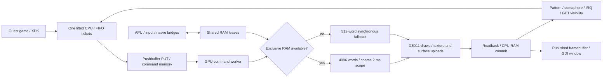

# Whole-system gameplay performance audit

## Final stopping point185

The user requested a handoff, documentation refresh, commit and push. No
further allocator work was started. All game/test processes are stopped.
Normal build185 links with the CS fast path off by default; it is unlaunched.
[HANDOFF.md](HANDOFF.md) is the operational authority. The sections below
record measurements made during the session, not current process state.

Run184 subsequently failed in exhibition loading after several idle-demo and
frontend cycles. Observed exit0xC0000005, fault RVA0x308EB63 maps to
sub_005E99A1+0x103; EAX/EBX contain0xBB55BB55 and fault VA is0xBB55BBD5.
Before the crash the contiguous arena reports66,960,000 bytes consumed of
67,108,864 and fails1,228,800/131,072-byte requests; later2560/1280-byte
requests also fail. Its selector gate never passed and no FPS comparison ran.

Source inspection finds a distinct lifetime defect: the contiguous allocator
is bump-only, while MmFreeContiguousMemory calls the ordinary heap free,
which has no contiguous allocation entries. Allocation-size queries also
consult only the ordinary heap. The failure follows exhaustion, but exact
poison propagation and any interaction with CS scheduling still need a
controlled reproduction. The fast path remains opt-in and unpromoted.

Next work is native contiguous allocate/free/query reproduction and a lifetime
repair across reserved ranges and aliases, followed by fresh normal and
demo-to-exhibition acceptance. Do not increase the arena to mask the leak.
Run182 was deliberately stopped after one pitch/count1–0 and pause/resume;
3451 PATH and zero logged crashes at its final audit. Build185 hashes and
process retirement/exit evidence remain private under build/.

2026-10-31. Objective: steady 30 FPS in actual gameplay, then rendering and
accuracy. Current evidence does not achieve that objective. The previous goal
turn made progress by preserving the earlier work and recording startup180's
failure. This turn reproduces a heap race, repairs it, rejects an unproven
bridge optimization, and measures the full active system before further work.

## Actual frame path and shared constraints

The CPU gate and RAM gate protect different things. Releasing the CPU for a
native kernel call does not necessarily release RAM; a retained bridge or
publication reference can keep GPU exclusion unavailable. Conversely, GPU
readback inside an exclusive scope blocks all RAM readers, including audio.
The command worker then feeds completion state back to the CPU which produces
more commands. Costs along this loop are coupled, not independent percentages.

The renderer currently returns results to RAM for every unscoped hardware draw
and at explicit observers/scope ends. Vertex work, fixed-function translation,
texture decode/cache checks, dynamic vertex uploads and driver calls also use
host CPU time. GDI redraws a published frame independently of game flips;
window refresh frequency is not gameplay FPS.

## Measurement environment

The host is a Ryzen 5 7520U, four cores/eight logical processors, with AMD Radeon
integrated graphics. CPU utilization was 100% in multiple system snapshots.
An unrelated project's native test process was a large CPU consumer; it was
identified by its executable path and left untouched. Other foreground work
also changes during this session. Therefore current rates are observations
under contention, not clean build-to-build regression measurements.

Two obsolete agent-owned MVP instances were deliberately stopped after saving
their log audits:178 PID18740 (3482 PATH, zero crashes) and181 PID29412 (3474
PATH, zero crashes). Private retire178/181.json record paths and reasons.
Normal181's launcher records forced exitFFFFFFFF. Candidate182 PID29996 was
the remaining game instance during profiling; it is now deliberately stopped.
No live EXE/MAP was relinked. Separate183 was built with the rejected bridge
change removed, but has not been launched or given gameplay acceptance.

Desktop capture frequently showed another foreground window. A read-only
private capture_present182.py now reads this game's published framebuffer,
validates loaded PE/MAP, and requires two identical full pixel snapshots before
writing a BMP. This is renderer evidence, with no remote calls, thread
suspension or input injection. system182_current.bmp confirms resumed 1-0
gameplay after the observed pause menu. The second pitch remains pending.

## Single-instance pipeline profile

Timing is enabled one way in the matching candidate182 (both frequencies set
before flags). It remains enabled; do not disable it inside a timed call or
describe subsequent measurements as a normal no-instrumentation baseline.
Profile and thread sampling are separate intervals. Private system182_timing.json
contains the 20.002-second sample:35 game flips,1.750 FPS, no shader compiles.

| Measured quantity | Over the interval | Per game flip |
| --- | ---: | ---: |
| Successful RAM resolves |2068|59.09|
| Scope-end resolves |838|23.94|
| Unscoped resolves |553|15.80|
| External observer resolves |587|16.77|
| Target-change resolves |90|2.57|
| Readback bytes |586.33 MB|16.75 MB|
| Surface upload bytes |571.52 MB|16.33 MB|
| Readback Map wall time |8.209 s|234.54 ms|
| Readback commit wall time |0.690 s|19.72 ms|
| Draw prepare wall time |2.030 s|58.01 ms|
| Surface work wall time |1.685 s|48.13 ms|

These timers overlap: texture work is inside prepare, comparison is inside
surface work, and some draw work includes flushes. Do not sum this table as a
frame-time partition. Map wall time includes driver/GPU waits and host
descheduling; it is not a GPU execution-time measurement. At 30 FPS the entire
frame budget is33.33ms, so reducing only copy bytes cannot solve this path.

Of external resolves,431 are pattern markers,98 software draws and58 clears.
Semaphores have647 observer calls but zero additional resolves because the
preceding pattern already committed. Removing one observer blindly can merely
move the same wait to the next observer. Memory/texture alias resolves are0
in this interval, not proof they are unnecessary generally.

RAM-reader acquisition waits sum39.613 seconds across threads; this is not a
percentage of the20-second interval. GPU-owned time is10.466 seconds; maximum
reader and GPU intervals are78.8/77.8ms. Flag-worker CPU time is687.5ms, much
smaller than its historical busy-poll cost. Audio accepts47,713 frames/s versus
48,000 nominal (99.4%); this does not establish audible continuity or absence
of rejected submissions with trace logging disabled.

A separate60-round RIP sample (system182_threads.txt) finds the renderer worker
in GPU synchronization syscalls24/60 times, delay16, single-object wait5,
plus vertex execution/readback/trap/driver work. Main game threads mostly sit
in CPU/lock/wait syscalls. These are instruction-pointer observations, not
unwound stacks or exact time fractions. The framebuffer thread sleeps57/60
samples and reaches GDI twice. There is no evidence here that presentation or
shader compilation is the primary bottleneck.

## Selected next change: schedule where blocking actually happens

The kernel summary reaches roughly1.43 million RtlEnterCriticalSection and
1.43 million RtlLeaveCriticalSection calls. Both currently park/rejoin the
lifted CPU even when a host critical section is uncontended. The actual
contended RtlEnter path also waits while retaining its bridge RAM lease.
This explains a system-wide pattern that a return-order tweak cannot fix:
CPU scheduling is performed for cheap lock operations, while real blocking
can retain precisely the RAM ownership the command worker needs.

Candidate184 work centralizes the existing kernel CPU policy, optionally keeps
Enter/Leave (277/278/294/295) on CPU, and must release CPU/RAM only during a
real passive-level critical-section wait. Toolkit default remains off until
runtime comparisons and gameplay acceptance justify promotion. Raised-IRQL
and publication contracts remain mandatory. Native tests must cover FIFO
policy, real lock contention, recursion, coherent GPU commits and raised IRQL
with GIL0/1 and both policy modes. Before the wait repair, the real-contention
fixture fails because no GPU lease can be acquired while the waiter blocks.
Afterward all four GIL0/1 x fastpath0/1 cases pass, as do the existing RAM-scope
and guest scheduler suites. Separate184 builds successfully. Runtime
comparison and gameplay acceptance remain pending; this is not promoted.

Beyond scheduling, reaching30 FPS still requires substantially fewer forced
GPU/RAM round trips. A resident-surface design needs precise CPU visibility,
all contiguous/tiled/public aliases, a private writeback view, host API buffer
probes, software writes, texture aliases and completion/IRQ ordering. Pattern
and semaphore publication cannot precede the RAM they certify. Do not skip
these contracts to improve a counter. See PERFORMANCE_WORK174.md for the
alias/protection obligations, and PERFORMANCE_WORK180_182.md for the rejected
return-order experiment and retained allocator repair.
